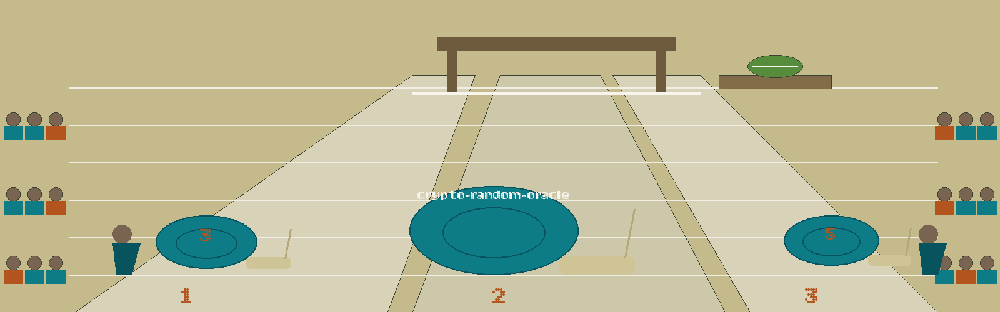

# crypto-random-oracle
Simulates a random oracle for cryptographic research and testing, outputting random values based on input with configurable entropy. - Focused on Basic cryptographic operations

## Install
`git clone https://github.com/ShadowStrikeHQ/crypto-random-oracle`

## Usage
`python3 main.py [params]`

Without a key the output is HKDF over the chosen hash and can be any
positive length. With `-k` the output is a single HMAC digest cut to
the requested length, so the length cannot exceed the digest size
(32 bytes for SHA256); a longer request fails with that reason instead
of printing a short output. A salt has no effect in HMAC mode and the
tool warns when one is supplied with a key.

## Parameters
- `-h`: Show help message and exit
- `-i`: The input string to the random oracle.
- `-l`: The length of the output in bytes (default: 32).
- `-s`: An optional salt for the random oracle. If not provided, a random salt is generated.
- `-n`: Number of outputs to generate for the same input and configuration.
- `-k`: An optional key for the HMAC. If not provided HMAC will not be used.
- `-a`: Hash algorithm to use (default: SHA256).

## License
Copyright (c) ShadowStrikeHQ
